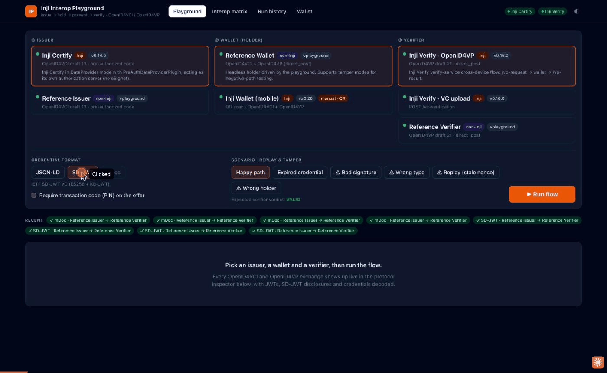

# Inji Interoperability Playground

A single web app for running the full verifiable-credential cycle (**issue → hold → present → verify**) across **Inji Certify**, wallets and **Inji Verify**. It also runs those against an independent, standards-based issuer, wallet and verifier, so you can see whether the stack interoperates with something other than itself. Every OpenID4VCI and OpenID4VP message is shown live, decoded, and drawn as a sequence diagram. Each run is graded pass/fail and kept in a history and a compatibility matrix.



```
 ┌──────────────┐  OpenID4VCI (pre-auth code)  ┌──────────────┐  OpenID4VP (direct_post)  ┌──────────────────┐
 │ Issuer       │ ───────────────────────────▶ │ Wallet       │ ────────────────────────▶ │ Verifier         │
 │ Inji Certify │   offer · token · proof JWT  │ Reference    │  request · vp_token ·     │ Inji Verify      │
 │ Reference    │   credential                 │ Inji Wallet📱│  presentation_submission  │ Inji Verify (VC) │
 └──────────────┘                              └──────────────┘                           │ Reference        │
                                                                                          └──────────────────┘
          every HTTP exchange ──▶ protocol inspector · live Mermaid sequence · pass/fail report
```

**Latest sweep** ([docs/INTEROP_REPORT.md](docs/INTEROP_REPORT.md)): 65 combinations, **59 pass / 6 fail**.
- **Happy path:** every combination interoperates. That includes Inji Certify → Inji Verify and both directions between Inji and the reference implementations.
- **Expiry and forgery:** correctly detected everywhere.
- **The 6 failures** are real gaps in Inji Verify 0.16: it accepts **replayed** presentations (the nonce is never checked) and JSON-LD presentations signed by the **wrong holder**.

There are 17 findings in total; see [docs/INTEROP_GAPS.md](docs/INTEROP_GAPS.md).

---

## Quick start

Requirements: Docker with the compose plugin. Allow about 4 GB of RAM for the containers. On Apple Silicon the images run natively (arm64).

```bash
./scripts/up.sh          # builds and starts everything, bootstraps Inji Certify
open http://localhost:4000
```

`up.sh` runs `docker compose --profile app up -d --build`. It then derives a `did:key` for Inji Certify's signing key, restarts Certify with that key as its issuer id, and registers the playground's credential configurations. It is idempotent, so re-running it is safe.

Run the CI-style sweep from the command line:

```bash
npm ci
npm run interop          # writes docs/INTEROP_REPORT.md; exit 1 if any happy-path combination fails
npm run interop -- --scenarios happy --formats ldp_vc   # subset
npm run interop -- --strict                              # also fail on negative-path findings
```

### Developing

```bash
npm ci
docker compose up -d --build     # Inji Certify, Inji Verify, Postgres, context mirror
npm run setup                    # bootstrap Certify (did:key issuer + credential configs)
npm run dev -w apps/server       # API + reference parties on :4000 (watch mode)
npm run dev -w apps/web          # UI on :5173, proxied to :4000
npm test                         # unit tests for the credential formats and proofs
```

| Port | Service |
|---|---|
| 4000 | Playground: UI, REST + WebSocket API, Reference Issuer (`/issuer`) and Reference Verifier (`/verifier`) |
| 8090 | Inji Certify 0.14.0, behind nginx (`/v1/certify/*` plus the root `.well-known` documents) |
| 8082 | Inji Verify service 0.16.0 (`/v1/verify/*`) |
| 5433 | Postgres 15 (`inji_certify`, `inji_verify`) |

---

## Using the playground

**Playground tab**
1. Pick one implementation for each role in the 3-column selector.
2. Pick a credential format and a scenario, then press **Run flow**.

The run view shows:
- the stage tracker (Issue → Hold → Present → Verify)
- the verdict, with the verifier's actual answer against the expected one
- every verification check
- a **live Mermaid sequence diagram**
- the **protocol inspector**

Click any inspector row to see the raw request and response, plus decoded artefacts: JWT headers and payloads, SD-JWT disclosures and KB-JWT, the credential, the presentation definition and the `vp_token`. Numbers like `[6]` match the arrows in the diagram.

| Role | Implementation | Version | Formats |
|---|---|---|---|
| Issuer | **Inji Certify**: pre-authorized code; Certify is its own authorization server (no eSignet) | 0.14.0 | JSON-LD, SD-JWT |
| Issuer | **Reference Issuer** (non-Inji): OpenID4VCI draft 13 | — | JSON-LD, SD-JWT, mDoc |
| Wallet | **Reference Wallet** (non-Inji): headless holder driven by the playground | — | all |
| Wallet | **Inji Wallet (mobile)**: manual; scan the QR codes the UI shows | ≥ 0.20 | all |
| Verifier | **Inji Verify · OpenID4VP**: `/vp-request` → wallet `direct_post` → `/vp-result` | 0.16.0 | JSON-LD, SD-JWT |
| Verifier | **Inji Verify · VC upload**: the QR-scan/upload path (`/vc-verification`) | 0.16.0 | JSON-LD, SD-JWT |
| Verifier | **Reference Verifier** (non-Inji): strict OpenID4VP relying party | — | JSON-LD, SD-JWT, mDoc |

**Formats:**
- W3C VC 1.1 JSON-LD with `Ed25519Signature2020`
- IETF SD-JWT VC (ES256, selective disclosure, KB-JWT holder binding)
- ISO 18013-5 mDoc/mDL (mock; device authentication over an OID4VP session transcript)

**Scenarios (replay & tamper):** each scenario sets the verdict the verifier is expected to give. A run **passes** only when the verifier gives that verdict, so a verifier that *accepts* a forgery fails the run.

| Scenario | What the wallet or issuer does | Expected |
|---|---|---|
| Happy path | Honest issuance and presentation | VALID |
| Expired credential | Issuer signs a credential whose validity has already ended | EXPIRED |
| Bad signature | Wallet edits a signed claim (or `exp`) after issuance | INVALID |
| Wrong type | Wallet rewrites `type` / `vct` | INVALID |
| Replay (stale nonce) | Presentation bound to an old nonce instead of the verifier's | INVALID |
| Wrong holder | VP / KB-JWT / DeviceAuth signed by a key the credential isn't bound to | INVALID |

**Interop matrix tab:** runs the whole issuer × verifier × format × scenario sweep and shows each cell as per-scenario pass/fail badges. Click a badge to open that run. **Download report** gives the markdown matrix.

**Run history tab:** every run, filterable by issuer, verifier, format, scenario, module version and outcome, with pass-rate stats. Use it for regression tracking across Inji releases.

**Wallet tab:** the credentials the Reference Wallet holds.

### Testing with the Inji Wallet mobile app

Select **Inji Wallet (mobile)** as the wallet. The run pauses and shows a QR code:
1. Scan the **credential offer** QR code in the app (enter the PIN if you enabled one).
2. Press **Credential received**.
3. Scan the **presentation request** QR code and share the credential.

The playground then shows the verifier's result.

The phone has to reach the services, so expose them (for example with ngrok or your LAN IP) and set:

```bash
PUBLIC_BASE_URL=https://<tunnel-to-4000>        # Reference Issuer / Verifier URLs in offers and requests
VERIFY_PUBLIC_URL=https://<tunnel-to-8082>/v1/verify   # Inji Verify response_uri
```

Inji Certify advertises `http://localhost:8090` as its issuer. To reach it from a phone, set `mosip.certify.domain.url` in `docker/inji-certify/certify-playground.properties` to the tunnel URL, then rebuild.

---

## Architecture

```
apps/server (Node 22, TypeScript, Express + ws)
  actors/issuer.ts        Reference Issuer: OpenID4VCI draft 13, pre-authorized code, tx_code,
                          c_nonce, proof-JWT validation; issues ldp_vc / vc+sd-jwt / mso_mdoc
  actors/wallet.ts        Reference Wallet: offer → metadata → AS metadata → token → proof → credential;
                          request_uri / presentation_definition_uri → vp_token → direct_post; tamper modes
  actors/verifier.ts      Reference Verifier: OpenID4VP (client_id_scheme=redirect_uri, direct_post);
                          checks issuer proof, holder binding, nonce/aud, submission, expiry
  adapters/inji-certify   /pre-authorized-data offers, credential-config bootstrap, did:key derivation
  adapters/inji-verify    /vp-request + status/result polling; /vc-verification
  formats/                ldp (digitalbazaar vc), sdjwt (jose, hand-rolled SD-JWT), mdoc (@auth0/mdl)
  http.ts + events.ts     every outgoing call is traced → WebSocket → inspector
  runs.ts / report.ts     orchestration, grading, persistence (data/runs), markdown matrix
  cli/setup.ts            Certify bootstrap · cli/interop.ts  CI sweep
apps/web (React 18, Vite, Tailwind 4, Mermaid, qrcode.react)
docker/                   derived images: Certify profile, Verify (+ fixed DDL), context mirror, nginx
```

Design choices that matter:

- **The playground traces from inside the conversation.** The inspector can show every payload because the Reference Wallet, or a playground adapter, is a party to each exchange. With a phone wallet, requests that reach the playground's own endpoints are still captured.
- **Inji Certify gets a `did:key` issuer.** Inji Verify only resolves `did:web` over https on the default port (gap V5), so Certify's default `did:web:localhost%3A8090` can't be verified locally. `npm run setup` derives a `did:key` from Certify's own Ed25519 key.
- **JSON-LD context mirror.** Both Inji services fetch W3C contexts on every request, and www.w3.org rate-limits that traffic (HTTP 429, gaps V3 and C2). `docker/context-mirror` serves the standard contexts over HTTPS for `www.w3.org` and `w3id.org`, and forwards anything else upstream. The certificate comes from a local test CA that is trusted **only inside the Inji containers**; its key is committed on purpose and protects nothing. To use the real hosts, delete the `extra_hosts` anchor in `docker-compose.yml`.
- **SD-JWT issuer certificates.** Inji Verify reads SD-JWT issuer keys only from `x5c` (gap V4), so the Reference Issuer signs with a document-signer certificate under its own IACA root. The same PKI signs the mDoc issuer certificate.
- **Flaky-run handling.** The sweep retries a failed run once. A pass on retry is reported as *flaky*, not clean.

## Limitations

- **Inji Web is not in the matrix.** It needs Mimoto plus eSignet login (authorization-code flow) and only issuers configured in `mimoto-issuers-config.json`, so it can't be driven headlessly. The Inji Wallet mobile app is supported in manual QR mode; that mode has not yet been tested against a physical device.
- **Inji Certify mDoc is not set up.** Certify issues mDoc only in `VCIssuance` plugin mode (profile `mock-mdl`), which excludes the pre-authorized `DataProvider` mode used here. mDoc is covered by the reference parties; Inji Verify 0.16 has no mDoc OpenID4VP or upload path (V8).
- **Unsupported protocol options:** `response_mode=direct_post.jwt`, deferred issuance and the authorization-code flow in the Reference Wallet. For mDoc over OpenID4VP, the wallet sends `mdoc_generated_nonce` as a form field, because there is no JWE `apu` with `direct_post`.

## Problem-statement checklist

| Task | Where |
|---|---|
| Stand up Certify, wallet and Verify end to end | `docker-compose.yml`, `scripts/up.sh` |
| 3-column Issuer → Wallet → Verifier selector | Playground tab |
| Live issue flow (offer, token, credential shown) | OpenID4VCI rows in the inspector and diagram |
| Live present & verify (Valid / Invalid / Expired) | OpenID4VP rows; verdict panel |
| Protocol inspector with raw payloads | Inspector with decoded JWT, SD-JWT, VP and PD |
| ≥ 2 formats, labelled per run | JSON-LD + SD-JWT (+ mDoc) |
| Pass/fail report per run | Verdict panel, Run history, `/api/report.md` |
| *Good to have:* non-Inji issuer, wallet and verifier · mDoc · animated Mermaid · replay & tamper · history dashboard | ✅ |
| *Bonus:* CI sweep · gap write-up and issue drafts · one-command bundle | `.github/workflows/interop.yml`, `docs/INTEROP_GAPS.md`, `scripts/up.sh` |
| *Good to have:* same-device flow | **Open in wallet on this device** deep link (`openid-credential-offer://`, `openid4vp://`) in manual mode |
| *Not done:* Digital Credentials API, Obsrv/Druid telemetry, Inji Web | — |
