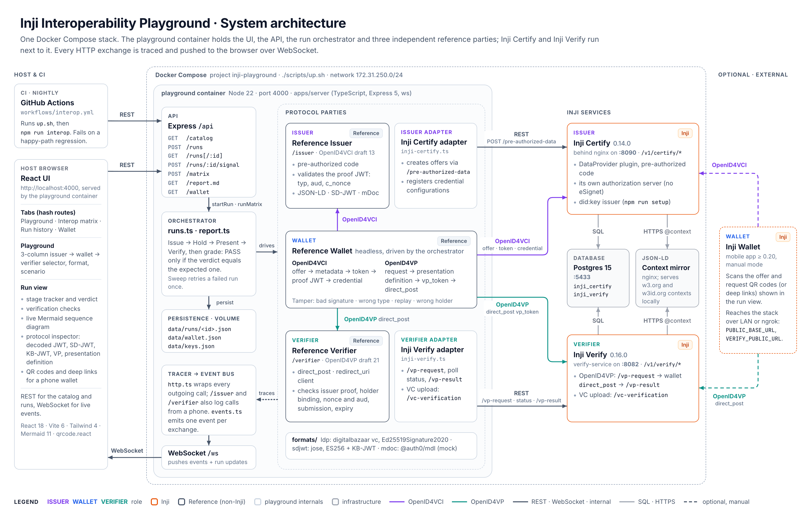
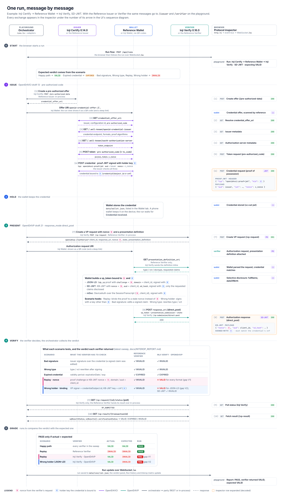
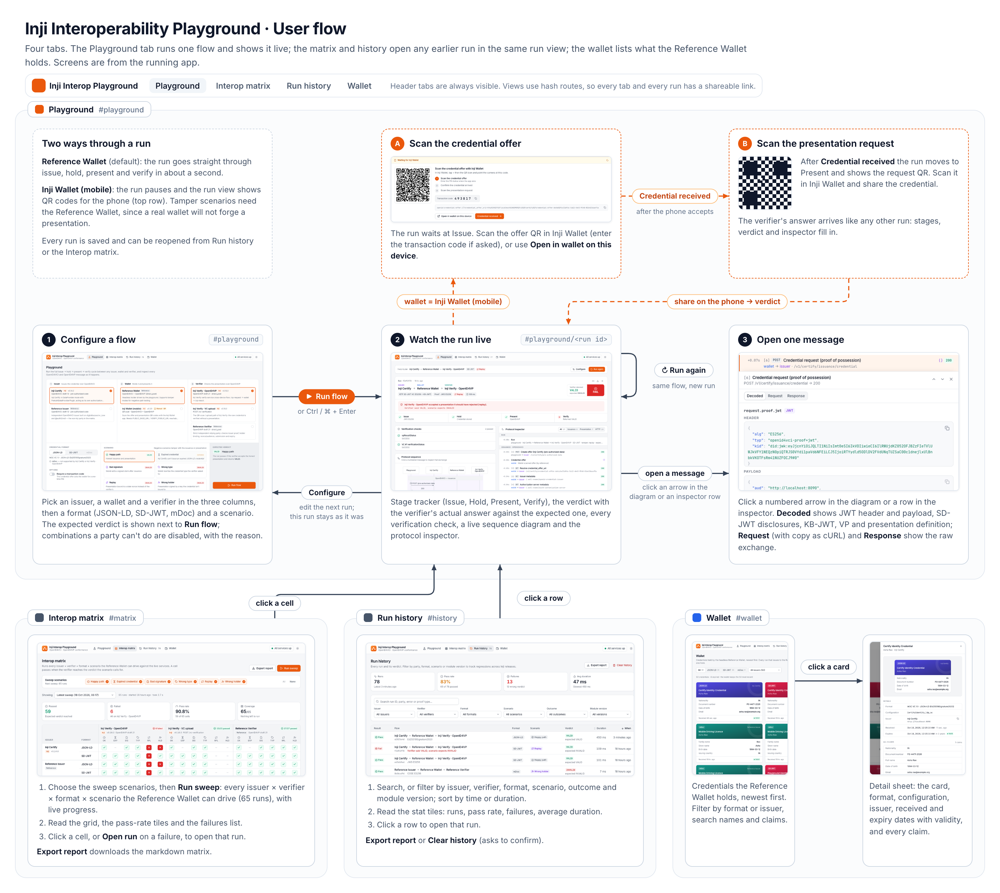

# Architecture and user flow

Three diagrams of the Inji Interoperability Playground: how it is deployed, what happens in one run, and how a user moves through the UI.

## System architecture

Everything runs from one `docker-compose.yml`. The playground container serves the React UI and the REST + WebSocket API, and it holds the orchestrator plus the three reference (non-Inji) parties. Inji Certify 0.14.0 (behind nginx on :8090) and Inji Verify 0.16.0 (:8082) run beside it, sharing Postgres and a local JSON-LD context mirror. Edge colours show the protocol: violet for OpenID4VCI, teal for OpenID4VP, slate for REST and WebSocket. The dotted "traces" edge is the reason the inspector can show every payload: `http.ts` wraps each outgoing call, and `events.ts` pushes every exchange to the browser over `/ws`.

## One run, message by message

It follows the message sequence of a real Inji Certify → Reference Wallet → Inji Verify SD-JWT run. The numbers match the UI's inspector rows and sequence-diagram arrows. Two tokens are tracked through the whole run: the verifier's nonce **N** (pink) and the holder key **K** (blue). The step-4 table shows where the findings are: Inji Verify accepts a presentation bound to a stale nonce (gap V1) and a JSON-LD presentation signed by the wrong holder (gap V2). The Reference Verifier rejects both, so those runs FAIL against Inji Verify and PASS against the reference.

## User flow

The Playground tab goes from configure to the live run view to one decoded message. **Run again** repeats the same flow, and **Configure** edits the next one. The orange dashed path is the manual Inji Wallet branch, where the run pauses for the phone to scan the offer QR and then the request QR. The Interop matrix and Run history tabs open any earlier run in the same run view. The Wallet tab lists what the Reference Wallet holds. The thumbnails are screenshots of the running app.

---

Sources are in [`src/`](src): one HTML file per diagram, plus shared CSS and JS. After `npm ci`, re-render the PNGs (2×, Playwright + Chrome) with `python3.11 -I docs/architecture/src/render.py`.
